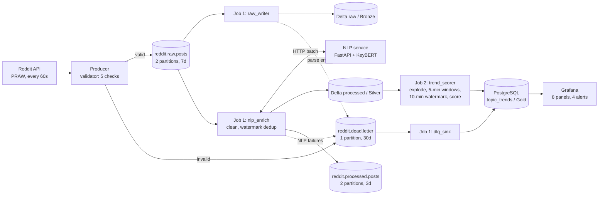

# Reddit Trend Tracker

A real-time streaming pipeline that detects which topics are gaining momentum on
**r/worldnews** and **r/todayilearned**. Posts are pulled from the Reddit API,
buffered in Kafka, enriched with KeyBERT topic tags, stored in a Delta Lake
lakehouse, scored over 5-minute windows with Spark Structured Streaming, and
shown on a live Grafana dashboard.

The whole stack runs locally with one command: `make up`.

   

## Architecture



| Stage | What happens |
|---|---|
| **Producer** | Polls `new` posts every 60 s, hashes usernames, validates them (5 checks), and publishes JSON keyed by `post_id`. Each subreddit gets its own partition. Settings: `acks=all`, `enable.idempotence=true`. |
| **Kafka** | Runs in KRaft mode (no ZooKeeper). It decouples ingestion from processing and keeps 7 days of posts for replay. |
| **Spark Job 1** | Runs three streaming queries in one driver. `raw_writer` writes Bronze. `nlp_enrich` cleans the text, deduplicates with a 10-minute event-time watermark, calls the NLP service once per micro-batch and writes Silver. `dlq_sink` mirrors the dead-letter topic into Postgres. |
| **NLP service** | KeyBERT with `all-MiniLM-L6-v2` on CPU. The model loads once at startup. Keyphrases are normalised (lowercased, plurals folded, a stoplist applied) so that "Floods" and "flood" trend together. |
| **Delta Lake** | Stored on an S3-compatible object store and partitioned by `subreddit` and `created_date`. Writes use an insert-only `MERGE` on `post_id`, which is idempotent on retry and keeps the table a valid streaming source. |
| **Spark Job 2** | Streams Silver, explodes topics into rows, and aggregates `(topic, subreddit, 5-min window)`. It computes the trend score and upserts into Postgres (`ON CONFLICT DO UPDATE`). |
| **Grafana** | The datasource, dashboard and alert rules are all provisioned from files, so no setup is done by hand. |

### Trend score

```
trend_score = 0.5 × velocity + 0.3 × ln(engagement + 1) + 0.2 × avg_upvote_ratio
velocity    = posts in window / 5 minutes
engagement  = summed post score
is_trending = post_count >= 2 AND trend_score >= TREND_THRESHOLD (default 1.0)
```

The log keeps engagement bounded: 50,000 upvotes add about 3.2 points. A single
viral post can still outscore a genuine burst of posts, though. The
`post_count >= 2` guard is what keeps one post from being flagged as a trend
(see `tests/unit/test_scoring.py`). Windows with `avg_upvote_ratio < 0.5` are
flagged as **controversial**.

## Quickstart

Requirements: Docker Desktop with about **5 GB of memory** allocated
(Settings → Resources), and `make`.

```bash
git clone https://github.com/<you>/reddit-trend-tracker.git
cd reddit-trend-tracker
make up          # creates .env from .env.example, builds and starts 10 services
make ps          # wait until everything is healthy (the first build takes several minutes)
```

Open **http://localhost:3000**. The *Reddit Trend Tracker* dashboard is the home
page. Trend scores start appearing about 2–3 minutes after start-up.

| URL | What |
|---|---|
| http://localhost:3000 | Grafana dashboard (anonymous view; admin password in `.env`) |
| http://localhost:4040 / :4041 | Spark UI for Job 1 / Job 2 |
| http://localhost:8000/docs | NLP service OpenAPI docs |
| http://localhost:8080 | Kafka UI (`make tools`) |

Useful commands: `make trends`, `make dq`, `make dlq`, `make logs s=spark-job1`,
`make psql`, `make topics`, `make down`, `make reset`.

### Producer modes

| `PRODUCER_MODE` | Source | Needs |
|---|---|---|
| `synthetic` (default) | Generated posts with rotating "breaking" storylines. Every post is labelled (`flair: synthetic`, ids `t3_syn…`) | Nothing |
| `live` | Real r/worldnews and r/todayilearned via the Reddit API | A Reddit *script* app: set `REDDIT_CLIENT_ID`, `REDDIT_CLIENT_SECRET`, `REDDIT_USER_AGENT` in `.env` |
| `replay` | Re-streams `data/$REPLAY_FILE` with event times stamped to now | A JSONL file, e.g. one captured in live mode with `CAPTURE_PATH=/data/capture.jsonl` |

Two real subreddits post a few hundred times a day. In live mode, a topic
rarely gets two posts inside one 5-minute window, so expect few trends, or
lower `TREND_THRESHOLD`. Synthetic mode exists so the whole pipeline can be
demonstrated at a predictable rate.

## Data quality: 12 checks across 4 layers

Every check writes to the `dq_results` table (`make dq`).

| Layer | Where | Checks |
|---|---|---|
| 1. Producer | `producer/validator.py` | required fields, subreddit allowlist, upvote ratio in [0, 1], timestamp sanity, non-empty title |
| 2. Spark Job 1 | `spark/job1_ingest.py` | parse failure rate ≤ 5 %, duplicate rate ≤ 5 % (warn), NLP failure rate ≤ 10 % |
| 3. Spark Job 2 | `spark/job2_trend.py` | no negative or null scores, window integrity (exactly 5 minutes) |
| 4. Scheduled SQL | `dq/dq_scheduled.sql` | trend freshness ≤ 10 min, trending topics present in the last 30 min |

Failed records are never dropped silently. They go to `reddit.dead.letter`
with a reason tag (`missing_field:score`, `invalid_upvote_ratio`,
`parse_error`, `nlp_error`, …) and are mirrored into `dead_letter_events`.

**Grafana alerts:** stale trend scores (no write for 10 min), a DLQ spike
(more than 10 per hour), no trending topics for 30 min, and Kafka consumer lag
above 1,000 for 5 min.

### Recovering from an NLP outage

If the NLP service is down, Job 1 sends the whole micro-batch to the DLQ with
`nlp_error` instead of blocking. Re-publishing those messages to Kafka would not
help: they are older than the dedup watermark, so the stream would drop them
as late. Instead, a batch job reprocesses them from Bronze:

```bash
make backfill                    # NLP for every post in raw that is missing from processed
make backfill SINCE=2026-10-01
```

## Data model

| Layer | Table | Contents |
|---|---|---|
| Bronze | `s3a://reddit-lake/raw` | Every post as received, plus `raw_json` and Kafka partition/offset |
| Silver | `s3a://reddit-lake/processed` | Cleaned text, `topics ARRAY<STRING>`, `topic_scores ARRAY<DOUBLE>`, `nlp_model_version` |
| Gold | `postgres.topic_trends` | One row per `(topic, subreddit, window_start)`: counts, velocity, trend_score, is_trending, is_controversial |
| Ops | `dq_results`, `dead_letter_events`, `pipeline_metrics` | Data-quality results, dead letters, and micro-batch throughput and lag |

## Design decisions

Each one is recorded in [`docs/adr/`](docs/adr):

1. [Kafka between the producer and Spark](docs/adr/ADR-001-kafka-buffer.md)
2. [Delta Lake with insert-only MERGE](docs/adr/ADR-002-delta-lake-merge.md)
3. [KeyBERT as a separate service](docs/adr/ADR-003-nlp-microservice.md)
4. [Two Spark jobs joined by a Delta table](docs/adr/ADR-004-two-spark-jobs.md)
5. [PostgreSQL as the serving layer](docs/adr/ADR-005-postgres-serving.md)
6. [SeaweedFS as the local S3 store](docs/adr/ADR-006-object-store.md)
7. [JSON messages now, Avro + Schema Registry later](docs/adr/ADR-007-json-before-avro.md)

## Testing

```bash
pip install -r requirements-dev.txt
make check        # ruff + unit tests + compose file validation (needs the Docker CLI, not running containers)
make test-spark   # Spark local-mode tests (Java 17 + pip install pyspark==3.5.1)
```

CI (`.github/workflows/ci.yml`) runs four jobs:

- lint and unit tests
- Spark local-mode tests
- a Docker build of every image
- an **end-to-end smoke test**, which starts the full stack and asserts that trend scores reach Postgres with no failing Spark data-quality checks

## Project layout

```
producer/       PRAW / synthetic / replay sources, validator, Kafka publisher
nlp_service/    FastAPI + KeyBERT topic extraction
spark/          job1_ingest.py, job2_trend.py, backfill.py and shared modules
dq/             scheduled SQL checks (layer 4)
sql/            Postgres schema and the read-only Grafana role
kafka-setup/    topic creation (3 topics, 5 partitions)
grafana/        provisioned datasource, dashboard and alert rules
tests/          unit, Spark local-mode and end-to-end tests
docs/adr/       architecture decision records
```

## Cloud mapping

| Local | AWS |
|---|---|
| Kafka | Amazon MSK (or Kinesis Data Streams) |
| Spark containers | EMR on EKS / EMR Serverless, or Databricks |
| SeaweedFS + Delta | S3 + Delta Lake (same `s3a://` code) |
| NLP service | ECS Fargate behind an internal ALB |
| PostgreSQL | RDS for PostgreSQL |
| Grafana | Amazon Managed Grafana |

## Roadmap

- Avro + Schema Registry for the Kafka contract ([ADR-007](docs/adr/ADR-007-json-before-avro.md))
- Comment ingestion and sentiment as a fourth score component
- Recompute Gold windows after a backfill
- Distributed tracing across the producer, Spark and the NLP service

## License

MIT
